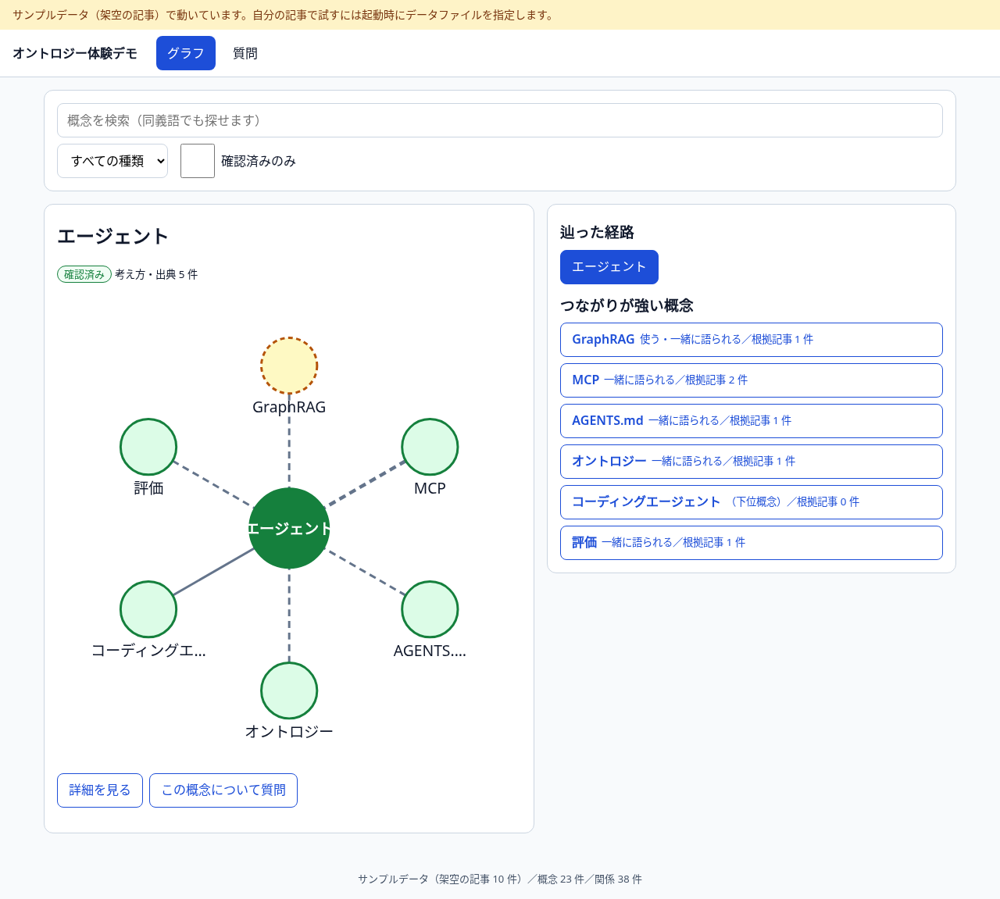
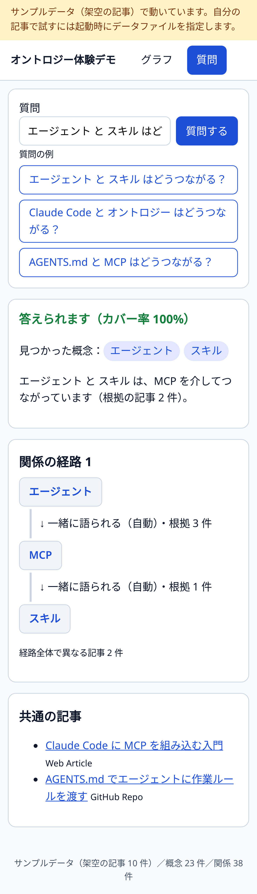

# 記事から自動で組み立てるオントロジー体験デモ

保存してある AI 関連の記事（JSON）から、**概念（用語）と概念どうしの関係**を自動で組み立て、
「辿る・調べる・質問する」でオントロジーのうれしさを体感するためのデモです。
NVIDIA/auto-ontology の考え方（下書きを自動生成 → 人が確認 → 根拠つきで答える）を、
**データベースもモデルも API キーも無し**で 1 コマンドで動く大きさに縮めています。
設計は [docs/DESIGN.md](docs/DESIGN.md)、作業ルールは [AGENTS.md](AGENTS.md)。



## 起動

Node.js 24 が必要です。

```bash
npm install                      # 初回のみ
npm start                        # サンプル（架空の記事 10 件）で起動 → http://127.0.0.1:5178
```

自分の記事データで動かすには、**リポジトリの外**にある JSON ファイルを `ARTICLES_PATH` で指します。

```bash
ARTICLES_PATH=/workspace/dev/auto-ontology-demo/local-data/articles-rows.json npm start
```

- 読める形：`{"results": [...]}` または記事オブジェクトの配列（Notion のデータベースを書き出した形を想定。欄は `Title` `userDefined:URL` `Summary` `Key Takeaways` `Knowledge Delta` `Content Type` `Source` `AI Score` など。欠けていても動きます）。
- ファイルのパスや中身は、画面・API 応答・ログに出しません。ファイルが無い・壊れているときは案内画面が出ます（サンプルには戻りません）。
- 組み立てだけ確認する：`npm run build:ontology`（件数と上位の概念を表示）。
- 開発：`npm run dev`（Vite とサーバーを同時に起動）。

| 環境変数 | 既定 | 意味 |
| --- | --- | --- |
| `ARTICLES_PATH` | 未設定＝サンプル | 記事 JSON のパス |
| `PORT` / `HOST` | `5178` / `127.0.0.1` | 待ち受け。iPhone 実機で見るときだけ `HOST=0.0.0.0` を自分で指定（家の中のネットワークだけで） |
| `ONTOLOGY_CACHE_DIR` | `.cache` | キャッシュ置き場（git 管理外） |
| `MIN_DF` / `MAX_CONCEPTS` / `MAX_RELATED` | `2` / `300` / `15` | 自動抽出のつまみ |
| `ASK_WITH_CLAUDE` | `0` | `1` で手元の `claude` CLI による要約を有効化（任意） |

## 何を体感できるか

1. **辿る**：中心の概念と、その隣の概念を放射状のグラフで見て、タップで中心を移していく（パンくずで戻れる）。確認済みは実線、自動抽出（下書き）は破線。
2. **調べる**：概念ごとに、関係（どの記事のどの文が根拠か）と出典記事を見られる。
3. **質問する**：「A と B はどうつながる？」に、**関係の経路と根拠の文・記事**で答える。記事に無いことは「答えられません」と正直に返す（カバー率つき）。



## しくみ（要点）

- 用語集 `ontology/glossary.ja.json` に載った概念＝**確認済み**。記事から規則で拾った語（英字の製品名、カタカナ語、「」で囲んだ語。2 記事以上に出るもの）＝**自動抽出（下書き）**。確認作業は用語集を編集して再起動することです。
- 関係は「同じ文に一緒に出る」＋手がかり語（「A と B を比較」「A に B を組み込み」など）＋用語集の関係。LLM は使いません。同じ入力からは毎回同じ結果になります。
- 質問は、表記ゆれを吸収した最長一致で概念を拾い、辺の重み（根拠の記事数）で最短経路を探します（最大 4 段・3 本）。

## 制約

- 抽出は**規則ベース**で、取りこぼしや誤りがあります（画面でも「自動抽出（下書き）」と表示）。精度は保証しません。
- 読み込めるのは書き出し済みの 1 ファイルだけ（ページ送りの統合はしません）。件数は決め打ちしていません。
- Notion との直接連携、認証、複数ユーザー、クラウド公開は対象外です。
- **任意機能**：`ASK_WITH_CLAUDE=1` かつ `claude` コマンドがあるときだけ、経路と根拠文を手元の `claude -p` に渡して 3 文の要約を作ります。**記事の文が Anthropic に送られます**。無効でも全機能が動き、テスト・CI では使いません。

## テスト

```bash
npm run typecheck && npm run lint
node scripts/check-secrets.mjs   # 秘密・個人情報・Notion データが追跡されていないか
npm test                         # 単体・API（Vitest）
npm run e2e                      # Playwright（desktop 1280x800 / iphone-390）。docs/screenshots/ にスクリーンショットを出す
```

テストとスクリーンショットは `fixtures/` の架空記事だけを使います（Notion のデータは使いません）。
初回の e2e の前に `npx playwright install chromium` が必要です。
